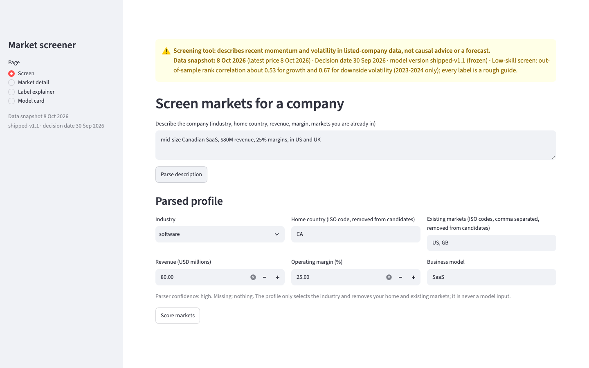
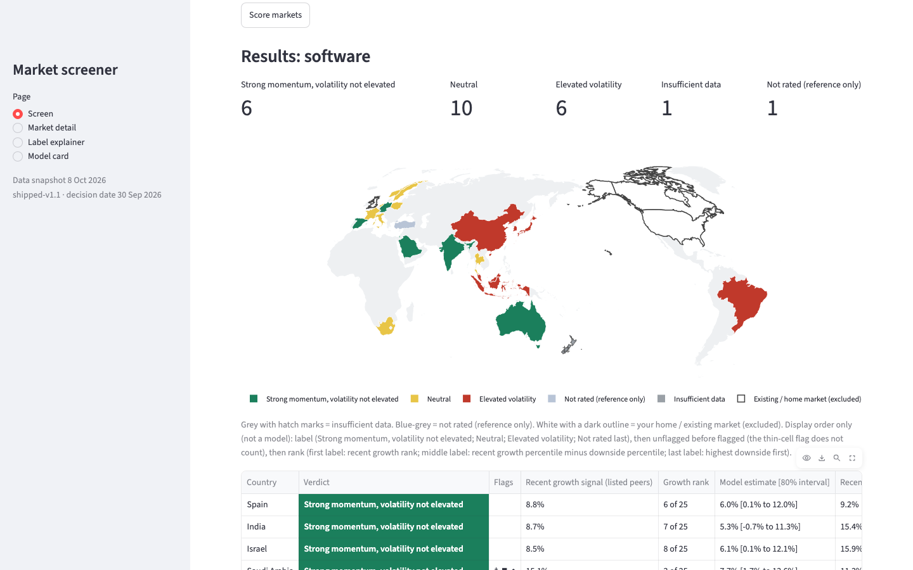
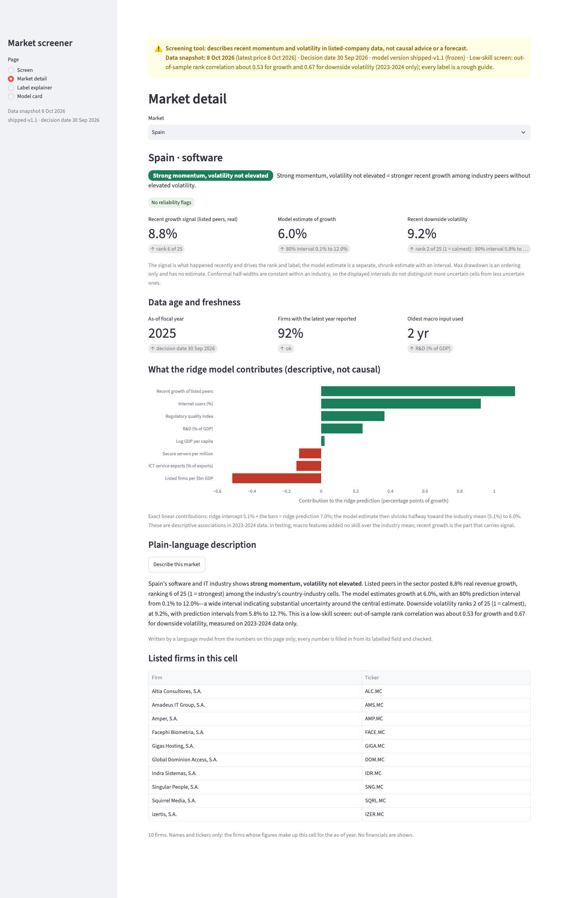
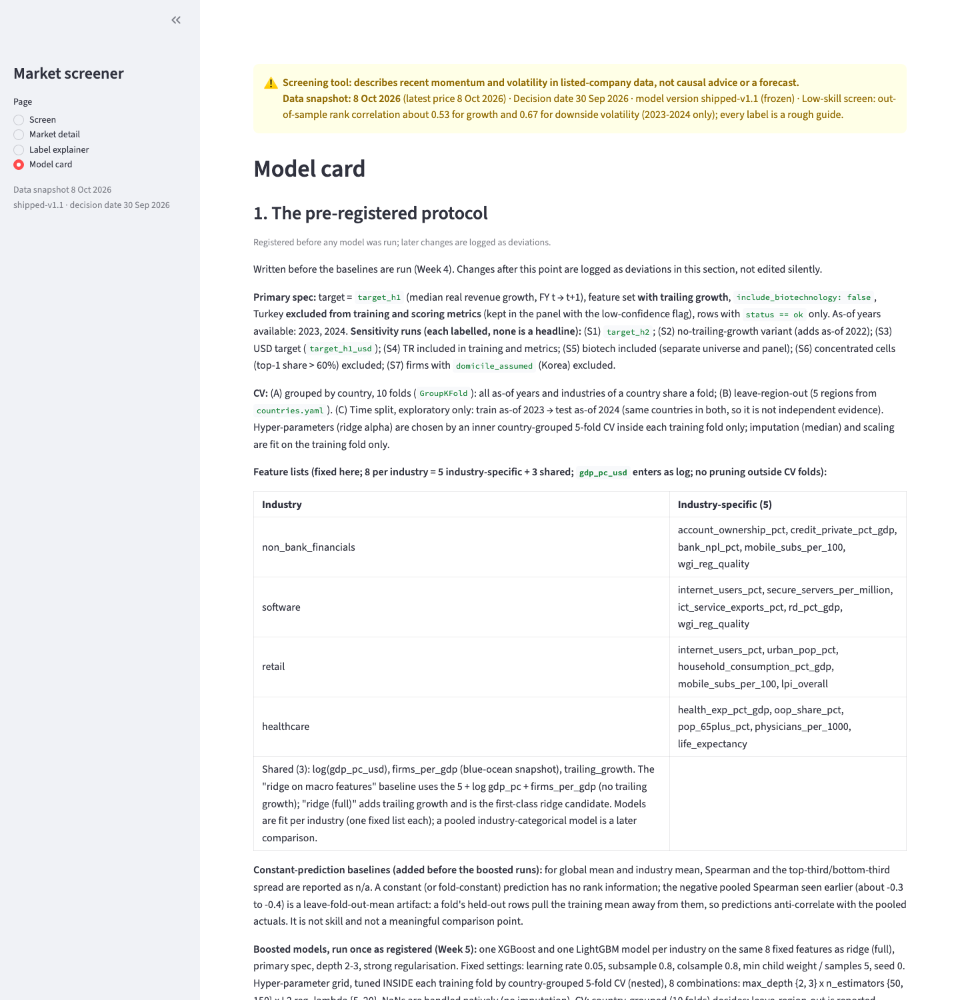

# WorldMarket: market-attractiveness screener

A local screener that takes a short company description and shows, for one of four industries (non-bank financial services, software and IT, retail and e-commerce, healthcare and pharma), how listed companies in about 30 countries have recently performed: revenue growth and downside price volatility, with ranks, 80% prediction intervals and a label. It is built only from free data (yfinance, World Bank, IMF). It is a screen, not advice and not a forecast. It grew out of an earlier market-scoring case project (13 retail markets), which is not part of this repository.

Model version `shipped-v1.1` (the first run, `shipped-v1`, is kept; the model card compares them). Decision date 30 Sep 2026. Data snapshot date: see `reports/data_snapshot.json` (shown at the top of every dashboard page). The model card (`docs/model_card.md`, also a dashboard page) and `PLAN.md` hold the full detail; nothing below goes beyond them.

## What I found

In these data, recent momentum and volatility persist from one period to the next, while macro indicators and boosted models did not add detectable value over simple baselines. One line per finding; the intervals, caveats and process notes are in the collapsed section below.

**What it is.** A market-screening tool over listed-company data for 4 industries and 30 countries. It describes recent revenue growth and downside price volatility; it is not causal advice and not a forecast. Version `shipped-v1.1`, data snapshot 8 October 2026.

- Recent growth ranks cells (Spearman 0.53) but explains little in levels (ridge R2 0.17).
- Macro features added no detectable skill (R2 0.08 against 0.10 for the industry mean).
- Boosted models were not promoted; on downside risk both ranked worse than persistence (Spearman difference -0.18 and -0.13).
- Downside volatility is the strongest signal (R2 0.36, Spearman 0.67).
- The v2 verdict labels passed their out-of-fold test (all 3 criteria).
- The blue-ocean hypothesis got no support; it was not tested on its own.

<details>
<summary>Evidence and caveats</summary>

29 of the 30 countries are in the evaluation sample (Turkey is scored for reference only). Brackets are 95% country-bootstrap intervals.

- **Recent growth ranks cells but explains little in levels.** Persistence Spearman 0.53 [0.39, 0.65]; top-minus-bottom-third spread 5.3 [2.4, 7.2] percentage points. The ridge with trailing growth, the core of the shipped growth estimate (which shrinks it halfway toward the industry mean), has R2 0.17 [0.02, 0.30]. LightGBM's R2 was higher, 0.21 [0.04, 0.31], but it was not promoted: the registered rule is paired differences (RMSE against the ridge with trailing growth, Spearman against persistence), not R2, and LightGBM's paired RMSE difference from the ridge, in its favour, was +0.001 [-0.001, 0.003], which includes zero.
- **Macro features added no detectable skill** (R2 0.08 [-0.05, 0.19] against 0.10 [-0.02, 0.19] for the industry mean; 29 countries, one regime). That is no detectable value at this sample size, not no effect.
- **Boosted models were not promoted** under the pre-registered rule (Spearman against persistence on growth: XGBoost -0.10 [-0.23, 0.02], LightGBM -0.08 [-0.22, 0.04]). On downside risk both ranked significantly worse: -0.18 [-0.34, -0.07] and -0.13 [-0.30, -0.01].
- **Downside volatility is the strongest signal:** R2 0.36 [0.09, 0.54], Spearman 0.67 [0.51, 0.78]. It held against a cell-composition control (firm count and top-firm share; Spearman advantage +0.61 [0.36, 0.85]) and on USD prices (R2 0.27 [0.01, 0.48]). Volatility clustering is a well-documented effect, so this is the expected result.
- **The v2 verdict labels passed their out-of-fold test.** "Elevated volatility" cells realized +0.041 [+0.025, +0.055] more downside deviation; "Strong momentum" cells +4.6 [+2.3, +7.1] percentage points more real growth and -0.017 [-0.031, -0.002] downside (partly mechanical). The growth evidence rests on 40 cell-years from 18 countries over two evaluation years (2023 and 2024). v1 labelled every cell "consider"; the v2 rule and its thresholds were set after seeing v1's direction-only counts, though before the v2 evaluation ran.

**Blue-ocean hypothesis.** The idea that low listed-company coverage relative to market size predicts higher growth was not tested on its own. Listed firms per $bn GDP is one input to the macro model, which showed no detectable skill, so these data give no evidence for it. Its bar in the contribution chart is a descriptive ridge coefficient, not evidence.

**Process.** Pre-registered protocol, country-grouped cross-validation, leakage tests. Bugs found and fixed, with deviation entries in [`docs/model_card.md`](docs/model_card.md):
- An HCLTECH.NS currency tag: 27 of 100 cells changed, largest growth-estimate change 0.027 percentage points, no verdict changes. The false "one firm over 60% of revenue" concentration flag on India software cleared (top-firm share 94.5% to about 22%).
- A stale selection-sensitivity report, written while a data fetch was still running.
- A Korea healthcare sampling figure in the scope limits (32 of 60 fetched firms) that matches the count from the unfinished fetch, not the final cache, which has 57 of 60 (see Scope limits).

**Limitations.**
- 2023-2024 evaluation window, one inflation and rate regime.
- Labels describe recent momentum, and most of the h=1 window has already elapsed.
- Growth is the global revenue of listed firms, not local demand.
- Many specifications were run on one dataset, so intervals that barely exclude zero deserve caution: the USD-price downside R2 lower bound is 0.01 and LightGBM's downside Spearman upper bound is -0.01.
- Survivorship: current listings only, four consecutive fiscal years required (see Scope limits). Frontier markets drop out.
- Non-bank financials is the least reliable industry (widest intervals, fewest scored cells).
- Turkey is shown as Not rated.
- Intervals have constant width within an industry.
- Narrations are model-written and vary between runs.

</details>

### Labels

The dashboard shows descriptive labels. The internal tier names stay in the data files, tests and the registered sections of the model card.

| Display label | Internal tier name | Rule (within each industry) |
|---|---|---|
| Strong momentum, volatility not elevated | expand | Top third of the industry on recent growth, and not in the top third on recent downside volatility |
| Neutral | consider | Not in the top third for recent growth and not in the top third for downside volatility; this includes markets with weak recent growth |
| Elevated volatility | avoid | Top third of the industry on recent downside volatility |
| Not rated (reference only) | consider | Turkey is scored for reference only (excluded from the model's training data); its internal tier is 'consider' but it is shown as Not rated |

**Reading the labels.** Tiers are thirds of the within-industry ranking, so two markets on either side of a cutoff (for example downside rank 16 vs 17 of 25) are not meaningfully different. Turkey is scored for reference only: it is shown as Not rated, and its growth is unadjusted for inflation (not CPI-deflated). Cells with fewer than 10 firms carry a display-only thin-cell flag (‡). Conformal half-widths are constant within an industry, so the displayed intervals do not distinguish more uncertain cells from less uncertain ones.

## Quick start

```bash
python3.14 -m venv .venv && .venv/bin/pip install -r requirements.txt
cp .env.example .env            # add ANTHROPIC_API_KEY; only the parser and the plain-language text use it
.venv/bin/streamlit run screener/app/app.py
.venv/bin/python -m pytest -q screener/tests          # offline; RUN_LIVE=1 adds the live canned prompts
```

The dashboard reads only committed files (`reports/`, `data/panel/`, `models/shipped_v1_1/`); it needs no raw data. Without an API key the Screen page cannot parse a description, but the Label explainer and Model card pages work. There is also a command line: `.venv/bin/python -m screener.cli "<description>" --yes`.

## Refresh procedure

Raw pulls are cached as parquet in `data/raw/` (not committed) and are never re-fetched, so a refresh means deleting the cache for what you want to update. **yfinance revises historical financials and prices and changes what its screener returns, so a refresh will not reproduce the numbers in this README or the model card.** Re-run the evaluation and re-check the pass criterion before shipping labels (`score_cells` only writes labels if `reports/verdict_v2_decision.json` says `passed`).

Approximate times are from this build, on a laptop, with yfinance rate limits; they are not benchmarks.

| Step | Command | Time |
|---|---|---|
| 1a. Universe quotes | `python -m screener.ingest.universe` (needs network; writes `data/raw/spike_quotes.parquet`) | about 1 min (704 screener calls, measured once) |
| 1b. Universe rules | `python -m screener.ingest.spike_cells` | hours (domicile lookups, rate limits and retries) |
| 2. Macro | `python -m screener.ingest.macro` | up to about 2 h |
| 3. Financials | `python -m screener.ingest.financials` | about 6 h for about 3,200 firms, with retries |
| 4. Panel | `python -m screener.features.run_panel` (optional report: `python -m screener.clean.gate2`) | minutes (not timed) |
| 5. Prices and FX | `python -m screener.ingest.prices`, `python -m screener.ingest.fx` (both read the panel's firm list) | about 1.5 h, about 1 min |
| 6. Price targets | `python -m screener.features.price_targets`, then `... price_targets usd` | minutes (not timed) |
| 7. Evaluation (optional) | `python -m screener.model.baselines`, `...model.risk_models`, `...model.risk_controls`, `...score.verdict_v2_eval` | tens of minutes (not timed) |
| 8. Scoring | `python -m screener.score.score_cells`, `...score.annotate`, `...score.snapshot`, `...score.comparable_firms` | minutes (not timed) |
| 9. Checks | `pytest -q screener/tests`; `RUN_LIVE=1 pytest -q screener/tests/test_canned_live.py`; `python -m screener.parse.holdout holdout` | under a minute; about 30 s; a few minutes (not timed) |

Step 1a refuses to overwrite an existing `data/raw/spike_quotes.parquet` unless you pass `--force`; it caches each country-industry query under `data/raw/universe_parts/`, so an interrupted run resumes, and it logs failed queries to `reports/fetch_failures.csv`. yfinance's screener results change over time: a fresh pull on 8 Oct 2026 reproduced 7,876 of the 7,981 symbols in the cache this build was scored from (after the exchange filter) and the cell counts moved by a few firms in many cells and by up to 19 in one, so a refresh gives a different universe. Steps 1 and 4 write firm-level files (the firm list and the per-firm panel) that the later steps read. The dashboard does not need them: it reads the cell-level panel and `data/panel/comparable_firms.csv` (firm names and tickers only).

Notes. The decision date and as-of years are in `screener/config/settings.yaml`; `DECISION_DATE` in `screener/app/services.py` and the caveat text in `screener/parse/narrate.py` repeat it by hand, so update all three. Generated files carry a version suffix (`_v1_1`, set by `TAG` in `screener/features/run_panel.py`; `WM_TAG=` with an empty value rebuilds the v1 file names), and `python -m screener.score.freeze` writes the shipped models into `models/shipped_v1_1/`; for another refit, change `TAG`, `MODELS` and `MODEL_VERSION` first so earlier versions are not overwritten. Per-firm currency corrections live in `data/panel/currency_overrides.csv`; every panel build also prints a report-only check of currency tags (`screener/clean/currency_check.py`) that never changes data. `python -m screener.score.compare_versions` rewrites the v1 vs v1.1 comparison, including the matching block of the model card.

## Scope limits

The screener only covers countries with listed-market depth. Universe rules: primary exchanges only; firms deduplicated by name within a country (yfinance exposes no usable ISIN); a firm counts only if its domicile equals the listing country (Korea's unresolved KOSDAQ/KOSPI domiciles are assumed domestic and flagged `domicile_assumed`). Frontier markets (and the dropped countries: AE, CO, EG, PH, VN have zero screener coverage; IE has none either; Nigeria and Kenya have no yfinance region; Taiwan lacks structural macro data; Argentina is configured but has fewer than 5 domestic listed firms in every industry, so it has no cell in the panel) are absent or fall out as `insufficient_data`, so the blue-ocean (thin-listed-market) test only covers countries above the minimum-firms threshold. It cannot say anything about markets with no listed depth, and a thin cell in a covered country is not evidence of whitespace elsewhere.

Further limits. (a) **Target years are fiscal 2023-2025 only** (as-of 2022-2024, base years FY2022-FY2024): the post-pandemic inflation and rate regime, so nothing here says how the model behaves in other regimes. (b) **Survivorship:** a firm needs at least four consecutive fiscal years of revenue, which excludes recent listings, and yfinance holds current listings only. (c) **Korea healthcare sampling (corrected 2026-10-16):** 57 of the 60 fetched firms have four fiscal years of revenue and CPI, and the cell has 25 members in every as-of year, so it is not thin. An earlier figure of 32 of 60 matches the number of Korea healthcare firms cached before the financials fetch finished (32 at 00:25 on 2026-10-08, the stale selection-sensitivity state), so it probably came from that incomplete cache. Two more. (1) **Listed-firm growth reflects global revenue, not home-market demand**: a listed firm's revenue growth comes from everywhere it sells (a Swiss pharma or an HK-listed firm with mainland operations), so the target measures how listed firms domiciled in a country grow, not how fast demand grows inside that country. (2) **Blue-ocean counts are a current snapshot**: `n_listed_cell`, `firms_per_gdp`, `firms_per_capita`, `cell_mktcap_to_gdp` and `country_listed_4ind_per_gdp` use today's listings and market caps (uncapped), not as-of-dated values, and carry survivorship. They are flagged `SNAPSHOT_COLS` in the panel builder.

## Screenshots

Captured at 1440 px wide against the local dashboard with the prompt `mid-size Canadian SaaS, $80M revenue, 25% margins, in US and UK`. Re-capturing needs the dev-only tools in `requirements-dev.txt` (Playwright, kaleido).









## What this repository leaves out

This is a clean export. Firm-level files (the per-firm panel, the firm list and the fetch-failure log) and the raw yfinance, World Bank and IMF caches are not included; the pipeline regenerates them (see "Refresh procedure"). What is included is the code, the configuration, the cell-level panel and price targets, the shipped models, the evaluation reports and the scored cells. `data/panel/comparable_firms.csv` lists firm names and tickers per cell, with no financials, prices or market caps. The scripts that build the firm-level files (`screener.ingest.*`, `screener.features.run_panel`) will not run until the earlier steps have produced their inputs.

## Data sources

Prices, company financials and listings come from Yahoo Finance through the `yfinance` package; macro indicators come from the World Bank (World Development Indicators and Worldwide Governance Indicators) and the IMF DataMapper. The raw downloads are not redistributed here. The repository contains derived aggregates only (cell-level panels, price-target indices, scores and evaluation reports), plus firm names and tickers in `data/panel/comparable_firms.csv`. The terms of each data source apply to anything you re-download or reuse. The folder `data/raw/` is created by the pipeline when you run the ingest steps; it is not part of the repository.

## License

The code is released under the MIT License (see `LICENSE`). The data files are derived from third-party sources and are not covered by that license.
